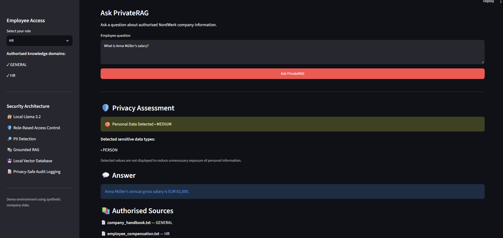

# PrivateRAG

**Privacy-Aware Enterprise AI for Secure Internal Knowledge Retrieval**

PrivateRAG is a privacy-aware Retrieval-Augmented Generation (RAG) prototype designed to explore how organisations can use generative AI with internal company knowledge while maintaining access controls, personal-data awareness, local inference, and privacy-safe auditability.

The system combines local LLM inference, role-based document retrieval, PII detection, semantic search, and minimal audit logging in a single Streamlit application.

The project uses **NordWerk Solutions GmbH**, a fictional German technology company, with entirely synthetic demonstration data.

---

## Application Demo

The interface demonstrates privacy assessment, role-based access control, authorised retrieval, grounded local LLM responses, and privacy-safe audit logging.



In this example, an HR user asks for an employee's salary. PrivateRAG detects personal information in the query, verifies the user's authorised knowledge domains, retrieves the HR compensation record, and generates the answer from the authorised internal context.

A General or IT user does not receive access to the HR compensation document.

---

## Project Motivation

Generative AI can make internal organisational knowledge easier to access, but enterprise adoption introduces several practical challenges:

- How can confidential documents remain access-controlled?
- How can personal information be identified during AI interactions?
- How can employees query internal knowledge without sending company data to a public LLM API?
- How can AI interactions be audited without unnecessarily storing sensitive prompts?
- How can generated answers remain grounded in authorised company information?

PrivateRAG was developed as a prototype for investigating these problems in a local and data-conscious enterprise AI architecture.

---

## Architecture

```text
Employee Question
        |
        v
+---------------------------+
| Privacy / PII Scanner     |
| Microsoft Presidio        |
+------------+--------------+
             |
             v
+---------------------------+
| Role-Based Access Control |
+------------+--------------+
             |
             v
+---------------------------+
| Authorised Retrieval      |
| ChromaDB + Embeddings     |
+------------+--------------+
             |
             v
+---------------------------+
| Local Language Model      |
| Llama 3.2 via Ollama      |
+------------+--------------+
             |
             v
+---------------------------+
| Grounded Answer           |
| + Authorised Sources      |
+------------+--------------+
             |
             v
+---------------------------+
| Privacy-Safe Audit Log    |
| SQLite                    |
+---------------------------+
```

A key design decision is that access control is applied during retrieval. Documents outside the user's authorised knowledge domains are filtered before context is provided to the language model.

---

## Key Features

### Local LLM Inference

PrivateRAG uses **Llama 3.2 through Ollama**.

The language model runs locally rather than requiring an external LLM API for the core demonstration.

This provides a practical environment for experimenting with data-sovereign enterprise AI architectures.

### Retrieval-Augmented Generation

Internal company documents are:

1. loaded from the local knowledge base,
2. divided into searchable chunks,
3. converted into vector embeddings,
4. stored in ChromaDB,
5. retrieved according to semantic relevance and user permissions,
6. supplied as authorised context to the local language model.

The generation prompt instructs the model to answer using the provided company context and to avoid inventing unsupported NordWerk information.

### Role-Based Access Control

PrivateRAG implements role-based retrieval permissions.

```text
General Employee  ->  General
IT Employee       ->  General + IT
HR Employee       ->  General + HR
Finance Employee  ->  General + Finance
```

For example, an HR employee can retrieve HR compensation information, while an IT or General employee cannot retrieve the same HR-only document.

Access filtering occurs before retrieved context is passed to the language model.

### PII Detection

PrivateRAG uses **Microsoft Presidio** to identify supported personally identifiable information in employee questions.

The current prototype checks for categories including:

- Person names
- Email addresses
- Phone numbers
- IBANs
- Credit-card numbers
- IP addresses

Detected PII values are not displayed in the application's privacy diagnostics.

### Privacy Risk Classification

Queries receive a simple prototype-level privacy classification:

```text
LOW
MEDIUM
HIGH
```

For example, supported personal identifiers such as names or email addresses may trigger a medium-risk classification, while supported financial identifiers such as an IBAN may trigger a high-risk classification.

This classification is a demonstration heuristic and should not be interpreted as a legal, regulatory, or compliance determination.

### Grounded Responses

The local language model is instructed to answer only from authorised retrieved context.

When the available authorised company information does not contain the requested information, PrivateRAG can return:

```text
I cannot answer this from the company information available to your role.
```

This reduces unsupported responses about fictional company information.

### Privacy-Safe Audit Logging

PrivateRAG records limited interaction metadata in a local SQLite database.

The audit log stores:

- timestamp,
- employee role,
- privacy-risk classification,
- detected PII categories,
- number of retrieved chunks.

The audit log deliberately does not store:

- the raw employee question,
- detected PII values,
- the generated answer.

This demonstrates how auditability can be introduced while reducing unnecessary retention of sensitive interaction content.

---

## Access-Controlled Retrieval Example

Consider the following question:

```text
What is Anna Müller's salary?
```

### HR role

The HR role has access to:

```text
GENERAL + HR
```

PrivateRAG can retrieve the synthetic HR compensation record and answer:

```text
Anna Müller's annual gross salary is EUR 82,000.
```

### General or IT role

The HR compensation document is excluded from authorised retrieval.

The system therefore cannot use that restricted document to answer the question.

This demonstrates that semantic relevance alone is not sufficient for retrieval. The document must also fall within the user's authorised knowledge domains.

---

## Technology Stack

| Component | Technology |
|---|---|
| Language | Python |
| User Interface | Streamlit |
| RAG Framework | LangChain |
| Local LLM | Llama 3.2 |
| Local LLM Runtime | Ollama |
| Vector Database | ChromaDB |
| Embeddings | Sentence Transformers |
| PII Detection | Microsoft Presidio |
| NLP | spaCy |
| Audit Storage | SQLite |

---

## Getting Started

### Prerequisites

Install the following before running the project:

- Python 3.11+
- Git
- Ollama

### Clone the repository

```bash
git clone https://github.com/SiddarthCharan05/PrivateRAG.git
cd PrivateRAG
```

### Create a virtual environment

#### Windows

```bash
python -m venv .venv
.venv\Scripts\activate
```

#### macOS / Linux

```bash
python3 -m venv .venv
source .venv/bin/activate
```

### Install dependencies

```bash
pip install -r requirements.txt
```

### Set up the local language model

PrivateRAG currently uses Llama 3.2 through Ollama.

```bash
ollama pull llama3.2:3b
```

Ensure Ollama is running before starting the application.

### Build the local vector database

```bash
python src/vector_store.py
```

This loads the synthetic NordWerk documents, creates document chunks and embeddings, and builds the local ChromaDB knowledge base.

### Run PrivateRAG

```bash
streamlit run src/app.py
```

Streamlit will normally make the application available at:

```text
http://localhost:8501
```

No external LLM API key is required for the core demonstration.

---

## Project Structure

```text
PrivateRAG/
|
|-- data/
|   |-- finance/
|   |-- general/
|   |   `-- company_handbook.txt
|   |-- hr/
|   |   `-- employee_compensation.txt
|   `-- it/
|       `-- ai_security_policy.txt
|
|-- screenshots/
|   `-- privaterag-hr-demo.png
|
|-- src/
|   |-- access_control.py
|   |-- app.py
|   |-- audit_logger.py
|   |-- document_loader.py
|   |-- privacy_scanner.py
|   |-- rag.py
|   `-- vector_store.py
|
|-- .gitignore
|-- README.md
`-- requirements.txt
```

Local runtime artifacts such as the virtual environment, ChromaDB database, and SQLite audit database are excluded from version control.

---

## Security and Privacy Design

PrivateRAG follows several prototype-level design principles:

**Authorise before generation**

Restricted documents are filtered during retrieval rather than relying on the language model to decide whether information should be disclosed.

**Local inference**

The core demonstration uses a locally running Llama model through Ollama.

**Data minimisation**

Privacy diagnostics expose detected PII categories rather than unnecessarily redisplaying detected values.

**Minimal audit retention**

Audit records contain operational metadata without storing raw prompts, detected PII values, or generated answers.

**Grounded generation**

The model receives explicit instructions to answer from authorised retrieved context rather than relying on unsupported company knowledge.

---

## Limitations

PrivateRAG is an educational and portfolio prototype rather than a production security system.

Current limitations include:

- demonstration-level role selection rather than authenticated identity management,
- heuristic privacy-risk classification,
- synthetic text-based company documents,
- limited document-level permission modelling,
- no production secrets management,
- no formal security testing,
- no regulatory or compliance certification.

The project does **not** claim GDPR compliance, legal compliance, regulatory certification, or production readiness.

---

## Roadmap

Potential future improvements include:

- authenticated user identities,
- document-level and attribute-based access control,
- PDF ingestion,
- automated unit and integration tests,
- retrieval confidence thresholds,
- improved source citations,
- administrative audit dashboard,
- Docker deployment,
- encrypted persistence,
- more advanced privacy policies,
- prompt-injection and retrieval-security testing.

---

## Disclaimer

NordWerk Solutions GmbH is fictional.

All company documents, employee records, salaries, email addresses, policies, and other organisational information included in this repository are synthetic and were created solely for demonstration purposes.

PrivateRAG is intended to explore privacy-aware, access-controlled, and data-sovereign enterprise AI patterns.

---

## Author

**Charan Siddarth**

Data Science | Artificial Intelligence | Data Analytics  
Germany

GitHub: [SiddarthCharan05](https://github.com/SiddarthCharan05)  
LinkedIn: [Charan Siddarth](https://www.linkedin.com/in/charansiddarth/)